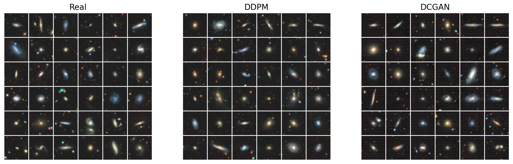

# Galaxy image generation: DDPM vs DCGAN

**AI4009 Generative AI, Fall 2026, course project**

We implement a denoising diffusion probabilistic model (DDPM) for galaxy image generation, following

> Smith, M. J., Geach, J. E., Jackson, R. A., Arora, N., Stone, C., Courteau, S. (2022). *Realistic galaxy image simulation via score-based generative models.* MNRAS 511. [arXiv:2111.01713](https://arxiv.org/abs/2111.01713) (PDF in [`paper/`](paper/))

and compare it with a DCGAN baseline on the Galaxy10 DECaLS dataset, downsampled to 32×32 pixels because of the compute budget.

**Group members:** `[Safia Mussarat (23k-0716)]`, `[Fatimah Riaz (23k-0687)]`, `[Meghna (23k-0507)]`
**Report:** [`report/`](report/) | **Proposal:** [`proposal/`](proposal/)

## What is implemented

| Part of the paper | Our implementation |
|---|---|
| DDPM forward/reverse process, noise-prediction loss (Eq. 7), ancestral sampling (Eq. 8) | `galaxy_ddpm_v2.py`: small U-Net (0.88 M parameters), T = 500 |
| FID (Sec. 4.1) | `pytorch-fid`, 2,100 generated vs 5,000 real images, with a real-vs-real floor |
| Synthetic Galaxy Distance (Sec. 4.1, Eq. 11) | Simplified: Wasserstein-1 over 4 image-derived properties, plus Cohen's d |
| Nearest-neighbour memorisation check (Fig. 3) | 8 samples per model |
| Satellite-trail inpainting (Sec. 4.2) | Guided reverse process, 8 examples |
| Not in the paper | DCGAN baseline, EMA weights |

## Results

Colab T4 run: DDPM and DCGAN each trained for 20 minutes of wall-clock time (DDPM: 39,794 steps), 2,100 samples from each.

| Metric | Real vs real (floor) | DDPM | DCGAN |
|---|---|---|---|
| FID (lower is better) | 4.43 | **17.55** | 57.00 |
| SGD-style sum (lower is better) | 0.845 | **2.034** | 15.289 |

Inpainting error on masked trail pixels (0 to 1 scale): DDPM 0.0245 vs 0.0902 for a median fill (an earlier independent draw gave 0.0279).



More figures are in [`results_v2/`](results_v2/): `loss.png`, `property_histograms.png`, `nearest_neighbours_ddpm.png`, `nearest_neighbours_dcgan.png`, `inpainting.png`, plus `metrics.csv` and `results.json`.

**Caveats.** An earlier 5-minute DCGAN run scored FID 50.25, so longer GAN training did not improve FID (GAN quality fluctuates between runs). The DCGAN was not tuned and used no EMA. The total-flux and half-light-radius properties are dominated by the sky background (no background subtraction), and the unnormalised SGD-style sum is dominated by the flux term. Evaluation images come from the training set (no held-out split), and results are from a single run. See the report for details.

## Repository structure

```
.
├── galaxy_ddpm_v2.py        # full pipeline: train DDPM, train DCGAN, sample, FID, metrics, figures, inpainting
├── galaxies_32.npy          # dataset used for training: 17,736 images, 32x32 RGB (Git LFS)
├── requirements.txt
├── notebooks/               # Colab notebooks used for the experiments
├── results_v2/              # figures, metrics.csv, results.json, DDPM checkpoint
├── paper/                   # reference paper (Smith et al.)
├── proposal/                # project proposal
└── report/                  # final report
```

There is no separate application: the deliverable is the training and evaluation pipeline and its results.

## Data

Galaxy10 DECaLS: 17,736 galaxy images (256×256, Legacy Surveys imaging with Galaxy Zoo labels). We use all images, area-downsampled to 32×32 and saved as `galaxies_32.npy` (float32, values in [0, 1]). The file is stored with Git LFS, so run `git lfs install` before cloning. If `galaxies_32.npy` is missing, the script downloads the original `Galaxy10_DECals.h5` from [Zenodo](https://zenodo.org/records/10845026) (about 2.7 GB) and rebuilds it.

## How to run

The final experiments ran on a free Google Colab T4 GPU (see `notebooks/`):

```bash
pip install -r requirements.txt
python -u galaxy_ddpm_v2.py --quick                           # ~2 min smoke test, writes results_quick/
python -u galaxy_ddpm_v2.py --train-min 20 --gan-min 5        # full run, writes results_v2/
```

Useful options: `--out` (output folder), `--n-gen` (samples per model; FID needs more than 2,048), `--load-ema` (reuse saved weights instead of training), `--skip-gan`. The script picks CUDA if available. A CPU-only run works but is much slower. Each stage is resumable.

## Deviations from the paper

- 32×32 images instead of 256×256, and Galaxy10 DECaLS instead of PROBES and SDSS.
- A 0.88 M-parameter U-Net without attention, T = 500 instead of 1000.
- 39,794 training steps (batch 64) instead of 750,000 (batch 56).
- EMA weights, which the paper does not describe.
- 2,100 generated and 5,000 reference images for FID instead of 10,000.
- A simplified four-property SGD-style metric instead of the paper's six, with no flux scaling correction.

## Acknowledgements

Paper and method: Smith et al. (2022). FID: [`pytorch-fid`](https://github.com/mseitzer/pytorch-fid) by M. Seitzer. Dataset: Galaxy10 DECaLS.
